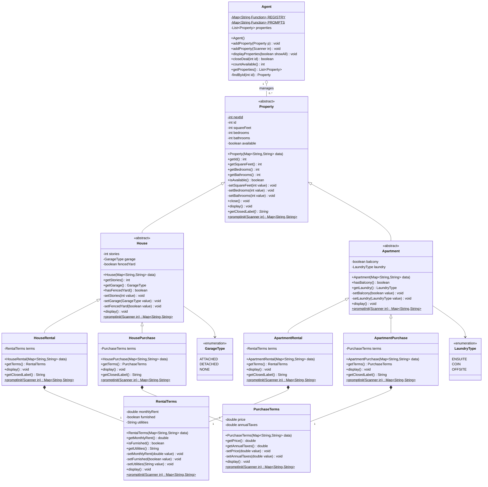

# Real Estate Application (OOP in Java)

Computer Programming 2, group assignment

| Student | Name | Student ID |
|---|---|---|
| 1 | Ali Ahmad Lutfi Samara | 26498 |
| 2 | Matteo Giorgetti | 25625 |

A console prototype for a real estate agent. The agent manages a list of houses and apartments that are offered either for rent or for purchase, and can add new properties, list the available ones, list all of them, and mark a property as sold or rented.

The design uses an inheritance hierarchy for the property type (house or apartment) and composition for the deal type (rental or purchase terms).

---

## Contents

1. [Features](#features)
2. [Project structure](#project-structure)
3. [Compile and run](#compile-and-run)
4. [Design](#design)
5. [Validation rules](#validation-rules)
6. [Sample run](#sample-run)
7. [AgentDemo output (testing)](#agentdemo-output-testing)
8. [Reflection](#reflection)
9. [Design notes and limitations](#design-notes-and-limitations)
10. [Rubric overview](#rubric-overview)
11. [Submission](#submission)

---

## Features

| Menu option | What it does |
|---|---|
| `1` Add property | Asks for the property type (house, apartment) and deal type (rental, purchase), then lets the matching class ask for its own details. Invalid input is re-prompted, so the user never has to start over. |
| `2` List available | Shows only properties that are still available. |
| `3` List all | Shows every property, including the ones marked `SOLD` or `RENTED`. |
| `4` Mark sold/rented | Closes a deal by id. Unknown ids, ids that are not numbers, and properties that are already closed are reported without crashing. |
| `0` Exit | Prints `Goodbye.` and ends the program. The program also exits cleanly if the input stream ends (Ctrl+Z / Ctrl+D). |

Editing property details and reactivating a closed property are out of scope, and the classes make both impossible from outside (all setters are private and `close()` is one-way).

---

## Project structure

The root of this repository is the `RealEstateApp` folder from the assignment.

```
RealEstateApp/  (repository root)
├── README.md
└── src/
    └── edu/uni/realestate/
        ├── model/
        │   ├── Property.java           abstract superclass (provided code)
        │   ├── House.java              abstract, extends Property
        │   ├── Apartment.java          abstract, extends Property
        │   ├── HouseRental.java        extends House, has RentalTerms (provided code)
        │   ├── HousePurchase.java      extends House, has PurchaseTerms
        │   ├── ApartmentRental.java    extends Apartment, has RentalTerms
        │   ├── ApartmentPurchase.java  extends Apartment, has PurchaseTerms
        │   ├── RentalTerms.java        monthly rent, furnished, utilities
        │   ├── PurchaseTerms.java      price, annual property taxes
        │   ├── GarageType.java         enum: ATTACHED, DETACHED, NONE
        │   ├── LaundryType.java        enum: ENSUITE, COIN, OFFSITE
        │   └── InputHelper.java        package-private console input helper
        ├── service/
        │   └── Agent.java              list of properties, add / display / close, type registry
        └── app/
            ├── Main.java               menu loop
            └── AgentDemo.java          test driver, no keyboard input
```

| Package | Contains | Access rule |
|---|---|---|
| `model` | Property hierarchy, terms classes, enums, `InputHelper` | `InputHelper` has no access modifier, so only model classes can use it |
| `service` | `Agent` | Depends on `model` only; never prints the menu or reads menu choices |
| `app` | `Main` (menu loop) and `AgentDemo` (test driver) | Depends on `service` and `model` |

Dependencies point one way: **app → service → model**. No model class imports anything from `service` or `app`.

---

## Compile and run

Run every command from the project root (the folder that contains `src` and this README). Java 8 or newer is enough (tested with `--release 8` and with JDK 21). No IDE or build tool is needed.

### Windows (Command Prompt)

```bat
dir /s /b src\*.java > sources.txt
javac -d out @sources.txt
java -cp out edu.uni.realestate.app.Main
```

> If the full folder path contains a space (for example `...\Computer programming 2\...`), `dir /s /b` writes unquoted absolute paths and `javac` fails with `invalid flag`. Either unzip the project to a path without spaces, or build the list with relative paths in PowerShell:
>
> ```powershell
> Get-ChildItem -Recurse src -Filter *.java | Resolve-Path -Relative | Set-Content -Encoding ascii sources.txt
> javac -d out "@sources.txt"
> java -cp out edu.uni.realestate.app.Main
> ```

### macOS and Linux (Terminal)

```bash
javac -d out $(find src -name "*.java")
java -cp out edu.uni.realestate.app.Main
```

### Run the tests (AgentDemo)

After compiling, on any platform:

```bash
java -cp out edu.uni.realestate.app.AgentDemo
```

`-d out` places each `.class` file under `out/edu/uni/realestate/...` to match its package, and `-cp out` points to the root of that package tree.

---

## Design

### UML class diagram

Inheritance carries the property type (house or apartment). Composition carries the deal type (rental or purchase), so the rental fields and the purchase fields are written once and shared by two classes each.



### OOP principles used

**Abstraction and a two-level inheritance hierarchy.** `Property`, `House` and `Apartment` are abstract, so only the four concrete classes can be created. Each constructor starts with `super(data)`, so `Property` validates its keys, then `House`/`Apartment` validate theirs, then the concrete class creates its terms object.

**Method reuse with `super.display()`.** Each level prints only its own lines: `Property.display()` prints the id, status and room counts, `House.display()` calls `super.display()` and adds stories, garage and fence, and `HouseRental.display()` calls `super.display()` and then `terms.display()`. No print line is repeated anywhere in the hierarchy.

**Polymorphism.** `Agent.displayProperties()` and `Agent.closeDeal()` work only with the `Property` type. The right `display()` and `getClosedLabel()` (`"RENTED"` for rental classes, `"SOLD"` for purchase classes) are chosen at runtime.

**Encapsulation.** Every field is private and has a public getter. Every setter is private and throws `IllegalArgumentException` for an invalid value; the constructor is the only caller. The only state change after creation is `close()`, which is one-way and throws `IllegalStateException` if the property is already closed. `Agent.getProperties()` returns `Collections.unmodifiableList(properties)`, and `getTerms()` is safe to expose because the terms classes have no public setters.

**Composition.** `RentalTerms` and `PurchaseTerms` do not extend `Property`. Each rental class *has* a `RentalTerms` and each purchase class *has* a `PurchaseTerms`, created and owned by the property (filled diamond in the UML), so the rent, price and tax rules are written exactly once.

**Static factory-style prompting.** Every class has `public static Map<String, String> promptInit(Scanner in)`. Each one calls its parent's (or the terms class's) `promptInit`, adds its own keys and returns the map; it never creates the object. Each concrete class has a constructor that accepts that map. This is the Java version of the case study's "static method that returns a dictionary".

**Agent knows no property details (bonus: registry, no switch).** `Agent` has no `switch` and no `if` chain over property types. It keeps a registry `Map<String, Function<Map<String, String>, Property>>` of constructors (`HouseRental::new`, ...) and a matching map of `promptInit` method references, both filled by one `register(...)` line per type in a static block. The type and deal choices shown to the user are taken from the registry, so adding a new property type only needs one new `register` line; `addProperty(Scanner)` itself does not change. Agent never reads or prints a property attribute itself: it only calls `promptInit`, constructors, `display()` and `close()` (plus `getId()` / `isAvailable()` from `Property` to find and filter).

---

## Validation rules

Private setters enforce the numeric ranges and required utilities description, and enum parsing rejects unsupported choices. These checks also apply to maps built in code (as in `AgentDemo`). In the console, `InputHelper` re-prompts on invalid input. Boolean strings follow the assignment's `"yes".equalsIgnoreCase(text)` rule: `yes` becomes `true`, and any other value becomes `false`. The console restricts these strings to `yes` or `no`; direct maps must supply the correct strings themselves.

| Class | Field | Map key | Type | Valid values |
|---|---|---|---|---|
| Property | squareFeet | `sqft` | int | 1 or more |
| Property | bedrooms | `beds` | int | 0 or more (0 = studio) |
| Property | bathrooms | `baths` | int | 1 or more |
| House | stories | `stories` | int | 1 or more |
| House | garage | `garage` | GarageType | attached, detached, none |
| House | fencedYard | `fenced` | boolean | yes / no |
| Apartment | balcony | `balcony` | boolean | yes / no |
| Apartment | laundry | `laundry` | LaundryType | ensuite, coin, offsite |
| RentalTerms | monthlyRent | `rent` | double | greater than 0 |
| RentalTerms | furnished | `furnished` | boolean | yes / no |
| RentalTerms | utilities | `utilities` | String | not null or blank, e.g. "included" or "about 120 EUR/month" |
| PurchaseTerms | price | `price` | double | greater than 0 |
| PurchaseTerms | annualTaxes | `taxes` | double | 0 or more |

Parsing follows the assignment: `Integer.parseInt` / `Double.parseDouble` for numbers, `GarageType.valueOf(text.toUpperCase(...))` for enums, and `"yes".equalsIgnoreCase(text)` for booleans. The money setters also reject `NaN` and `Infinity`, which `Double.parseDouble` would otherwise accept.

`InputHelper` (package-private) provides the four required methods, each repeating its prompt until the input is valid and returning it as a `String`:

| Method | Accepts |
|---|---|
| `readInt(Scanner in, String prompt, int min)` | a whole number of at least `min` |
| `readDouble(Scanner in, String prompt, double min)` | a finite number of at least `min`; rent, price and taxes use `0`, and the rent and price prompts additionally reject zero |
| `readYesNo(Scanner in, String prompt)` | `yes` or `no`, any letter case |
| `readChoice(Scanner in, String prompt, String... options)` | one of the options, any letter case |

---

## Sample run

Real output of `java -cp out edu.uni.realestate.app.Main` with the input from the assignment (user input is shown after each prompt):

```
=== Real Estate Agent ===
1) Add property   2) List available   3) List all   4) Mark sold/rented   0) Exit
Choice: 1
Property type (house, apartment): house
Deal type (rental, purchase): rental
Square feet: 1400
Bedrooms: 3
Bathrooms: 0
  Please enter a number of at least 1.
Bathrooms: 2
Number of stories: 2
Garage (attached, detached, none): garage
  Please choose one of: attached, detached, none
Garage (attached, detached, none): attached
Fenced yard? (yes/no): yes
Monthly rent: 1850
Furnished? (yes/no): no
Utilities (included or estimated cost): about 120 EUR/month
Added property #1.

Choice: 2
PROPERTY #1 [AVAILABLE]
  Square feet: 1400
  Bedrooms:    3
  Bathrooms:   2
  Stories:     2
  Garage:      ATTACHED
  Fenced yard: yes
  Monthly rent: 1850.00 EUR
  Furnished:    no
  Utilities:    about 120 EUR/month

Choice: 4
Property id: 1
Property #1 marked as RENTED.

Choice: 4
Property id: 1
Property #1 is not available.

Choice: 2
No properties to show.

Choice: 0
Goodbye.
```

Invalid menu input is handled without crashing:

```
Choice: 9
Please choose one of the options below.
1) Add property   2) List available   3) List all   4) Mark sold/rented   0) Exit

Choice: 4
Property id: xyz
"xyz" is not a valid property id.

Choice: 4
Property id: 7
There is no property #7.
```

---

## AgentDemo output (testing)

`AgentDemo` (package `app`) needs no keyboard input. It builds one object of each concrete class directly from a `Map` and shows that:

1. invalid numeric ranges, unsupported enum values, blank utilities, a non-numeric value and `addProperty(null)` are rejected,
2. closing a property twice is rejected (`closeDeal` returns `false`, and calling `close()` again throws `IllegalStateException`),
3. closed properties disappear from the available list (`displayProperties(false)` vs `displayProperties(true)`),
4. the list returned by `getProperties()` cannot be modified,
5. and positive rent and price values below one cent are accepted.

Output of `java -cp out edu.uni.realestate.app.AgentDemo`:

```
=== 1. One object of each concrete class, built from a Map ===
PROPERTY #1 [AVAILABLE]
  Square feet: 1400
  Bedrooms:    3
  Bathrooms:   2
  Stories:     2
  Garage:      ATTACHED
  Fenced yard: yes
  Monthly rent: 1850.00 EUR
  Furnished:    no
  Utilities:    about 120 EUR/month

PROPERTY #2 [AVAILABLE]
  Square feet: 2200
  Bedrooms:    4
  Bathrooms:   3
  Stories:     2
  Garage:      DETACHED
  Fenced yard: no
  Price:        385000.00 EUR
  Annual taxes: 3200.00 EUR

PROPERTY #3 [AVAILABLE]
  Square feet: 650
  Bedrooms:    0
  Bathrooms:   1
  Balcony:     yes
  Laundry:     COIN
  Monthly rent: 900.00 EUR
  Furnished:    yes
  Utilities:    included

PROPERTY #4 [AVAILABLE]
  Square feet: 980
  Bedrooms:    2
  Bathrooms:   1
  Balcony:     no
  Laundry:     ENSUITE
  Price:        215000.00 EUR
  Annual taxes: 1450.50 EUR

Available properties: 4

=== 2. Invalid values are rejected ===
square feet = 0        -> rejected: Square feet must be at least 1
bedrooms = -1          -> rejected: Bedrooms cannot be negative
bathrooms = 0          -> rejected: Bathrooms must be at least 1
square feet = "abc"    -> rejected: For input string: "abc"
stories = 0            -> rejected: Stories must be at least 1
garage = "carport"     -> rejected: Garage must be one of: attached, detached, none
monthly rent = 0       -> rejected: Monthly rent must be greater than 0
utilities = "   "      -> rejected: Utilities description cannot be blank
laundry = "shared"     -> rejected: Laundry must be one of: ensuite, coin, offsite
price = -5             -> rejected: Price must be greater than 0
price = 0              -> rejected: Price must be greater than 0
annual taxes = -1      -> rejected: Annual property taxes cannot be negative
addProperty(null)      -> rejected: Property cannot be null
Properties managed by the agent: 4 (no invalid object was added)

=== 3. Closing a property twice is rejected ===
agent.closeDeal(1)  -> true   (#1 is now RENTED)
agent.closeDeal(1)  -> false  (already closed)
agent.closeDeal(4)  -> true   (#4 is now SOLD)
agent.closeDeal(99) -> false  (no such id)
houseRental.close() -> IllegalStateException: Property #1 is already RENTED

=== 4. Closed properties disappear from the available list ===
--- displayProperties(false): available only ---
PROPERTY #2 [AVAILABLE]
  Square feet: 2200
  Bedrooms:    4
  Bathrooms:   3
  Stories:     2
  Garage:      DETACHED
  Fenced yard: no
  Price:        385000.00 EUR
  Annual taxes: 3200.00 EUR

PROPERTY #3 [AVAILABLE]
  Square feet: 650
  Bedrooms:    0
  Bathrooms:   1
  Balcony:     yes
  Laundry:     COIN
  Monthly rent: 900.00 EUR
  Furnished:    yes
  Utilities:    included

--- displayProperties(true): all properties ---
PROPERTY #1 [RENTED]
  Square feet: 1400
  Bedrooms:    3
  Bathrooms:   2
  Stories:     2
  Garage:      ATTACHED
  Fenced yard: yes
  Monthly rent: 1850.00 EUR
  Furnished:    no
  Utilities:    about 120 EUR/month

PROPERTY #2 [AVAILABLE]
  Square feet: 2200
  Bedrooms:    4
  Bathrooms:   3
  Stories:     2
  Garage:      DETACHED
  Fenced yard: no
  Price:        385000.00 EUR
  Annual taxes: 3200.00 EUR

PROPERTY #3 [AVAILABLE]
  Square feet: 650
  Bedrooms:    0
  Bathrooms:   1
  Balcony:     yes
  Laundry:     COIN
  Monthly rent: 900.00 EUR
  Furnished:    yes
  Utilities:    included

PROPERTY #4 [SOLD]
  Square feet: 980
  Bedrooms:    2
  Bathrooms:   1
  Balcony:     no
  Laundry:     ENSUITE
  Price:        215000.00 EUR
  Annual taxes: 1450.50 EUR

Available properties: 2 of 4
After closing #2 and #3, displayProperties(false) prints:
No properties to show.

=== 5. getProperties() is read-only ===
agent.getProperties().clear() -> UnsupportedOperationException
Properties still managed: 4

=== 6. Positive rent and price below one cent are accepted ===
Monthly rent accepted: 0.001
Purchase price accepted: 0.001
```

---

## Reflection

**1. The setters in this design are private. What would break, or which rule could be bypassed, if `setBedrooms` were public?**

The "editing details is out of scope" rule would be bypassed. Any class could take a property from `agent.getProperties()` and call `setBedrooms(5)` on it, even after the property was marked `SOLD`. `Collections.unmodifiableList` only stops clients from adding or removing elements of the list; the `Property` objects inside it are only read-only because `Property` has no public setters. The validation itself (`value < 0` throws) would still run, so the value could not become negative, but the data the agent showed a client could silently change after the fact. Keeping `setBedrooms` private means the `Property` constructor is the only caller, so every bedroom count is checked once and then never changes.

**2. `HouseRental` and `ApartmentRental` both hold a `RentalTerms` object instead of inheriting rental fields. Why can Java not solve this with inheritance alone, and what would the code look like without composition?**

Java allows only single inheritance of classes: `HouseRental` already `extends House`, so it cannot also extend a `Rental` class. An interface could declare `getMonthlyRent()`, but an interface cannot hold the `monthlyRent`, `furnished` and `utilities` fields or private validating setters. Without composition, `HouseRental` and `ApartmentRental` would each need their own copy of the three fields, three getters, three validating setters, the rent `display()` lines and the rent prompts, and the two purchase classes would duplicate `price` and `annualTaxes` the same way: four copies of logic that must be kept in sync. With `RentalTerms`, the rule "rent must be greater than 0" exists in one setter (`RentalTerms.setMonthlyRent`), and each rental class only adds `terms = new RentalTerms(data)` and `terms.display()`.

**3. `promptInit` is static, so `HouseRental.promptInit` hides `House.promptInit` rather than overriding it. Explain the difference and why an instance method could not be used here.**

Overriding applies to instance methods: the JVM picks the version at runtime from the object's actual class, which is why `agent.displayProperties()` calls `HouseRental.display()` through a `Property` reference. A static method belongs to the class, so the call is fixed at compile time by the class name written in the code; `House.promptInit(in)` always runs House's version, even inside `HouseRental`, and putting `@Override` on `promptInit` is a compile error. An instance method could not work because `promptInit` runs *before* the object exists: its job is to collect the map that the constructor needs. Calling an instance method would require an object first, but our constructors refuse to build a `Property` without a complete, valid map. This is also why `Agent` stores method references such as `HouseRental::promptInit` in its `PROMPTS` registry instead of calling the method on an instance.

**4. Passing a `Map<String, String>` to constructors is flexible but not type-safe. Give one error the compiler would catch with a normal constructor but cannot catch with the map.**

A misspelled or missing key. If someone writes `data.put("bathrooms", "2")` instead of `data.put("baths", "2")`, the code compiles, but `data.get("baths")` returns `null` and `Integer.parseInt(null)` throws a `NumberFormatException` only at runtime. With a normal constructor such as `new HouseRental(1400, 3, 2, 2, GarageType.ATTACHED, true, 1850.0, false, "included")`, a missing argument does not compile. The same goes for wrong types: our `AgentDemo` passes `"abc"` as `sqft` and the error only appears when the program runs (`For input string: "abc"`), while an `int` parameter would have rejected a string at compile time.

**5. The model classes read from a `Scanner`. If the agent later moves to a GUI or web page, which classes must change? Propose where the prompting code should live instead.**

Every class that has a `promptInit` would have to change: `Property`, `House`, `Apartment`, `RentalTerms`, `PurchaseTerms` and the four concrete classes, plus `InputHelper`, `Agent.addProperty(Scanner)` with its `readChoice` helper, and `Main`. The `display()` methods also print straight to `System.out`, which a web page cannot use. This shows the layering problem: `model` depends on the console user interface, even though the dependency direction should be app → service → model with no UI in the model. We would move all prompting into the `app` layer, for example a `ConsolePropertyForm` class that builds the `Map<String, String>` for each type (a GUI would get its own `PropertyForm` that fills the same map from text fields), change `Agent.addProperty(Scanner)` to `addProperty(String kind, Map<String, String> data)` using the existing registry, and replace `display()` with a method that returns the text (for example `toString()` or `getDetails()`), so each UI decides how to show it. The validation stays in the private setters, so every user interface gets exactly the same rules.

---

## Design notes and limitations

- **Ids and failed validation.** The provided `Property` constructor assigns the id last, so a value rejected by `Property` itself (square feet, bedrooms, bathrooms) does not use up an id. Values checked by a subclass (stories, garage, laundry, rent, utilities, price, taxes) are validated *after* `super(data)` has returned, because Java requires `super(...)` to be the first statement. A rejected house or terms value therefore skips an id number. No invalid object is ever added to the agent, and the menu never hits this case because `InputHelper` re-prompts before the constructor is called. A fix would be to validate the whole map before calling `super(...)`, which would mean changing the provided code.
- **`AgentDemo` has its own `main` method.** The package table describes `Main` as the only class with a `main` method, but the testing task asks for a separate `AgentDemo` class that runs without keyboard input. We read the rule as "`Main` is the only interactive entry point": `AgentDemo` is a test driver with no menu, and it needs `main` so it can be run on its own (`java -cp out edu.uni.realestate.app.AgentDemo`).
- **Agent reads two choices itself.** `InputHelper` is package-private in `model`, so `Agent.addProperty(Scanner)` has a small private `readChoice` to ask for the property type and deal type, as required. It never reads property attributes; those prompts come from each class's `promptInit`.
- **Utilities prompt.** `InputHelper` has no method for free text, so `RentalTerms.promptInit` re-asks while the description is blank. The setter still rejects a blank value from a map (see AgentDemo), and `Main` catches `IllegalArgumentException` when adding and prints its message.
- **Locale.** Prices are formatted with `Locale.ROOT` and enum text is upper-cased with `Locale.ROOT`, so the output always uses a decimal point and enum parsing also works on a Turkish system locale.

---

## Rubric overview

| Criterion | Where to look |
|---|---|
| Enums and InputHelper (5) | `model/GarageType.java`, `model/LaundryType.java`, `model/InputHelper.java` (no access modifier; every method re-prompts until the input is valid) |
| House and Apartment (15) | `model/House.java`, `model/Apartment.java`: abstract, private fields, public getters, private validating setters, `display()` starts with `super.display()`, `promptInit` starts with `Property.promptInit(in)` |
| Terms classes (10) | `model/RentalTerms.java`, `model/PurchaseTerms.java`: not subclasses of `Property`, no public setters, validation as in the table above |
| Concrete classes (15) | `model/HousePurchase.java`, `model/ApartmentRental.java`, `model/ApartmentPurchase.java` follow the provided `HouseRental` pattern; rental classes return `RENTED`, purchase classes return `SOLD` |
| Agent (20) | `service/Agent.java`: every UML method, `getProperties()` returns `Collections.unmodifiableList`, no property attributes read or printed |
| Main menu (10) | `app/Main.java`: options 1, 2, 3, 4 and 0; catches `IllegalArgumentException` when adding; handles invalid menu choices, non-numeric and unknown ids, and end of input |
| AgentDemo testing (10) | `app/AgentDemo.java` and its output above: invalid values rejected, closing twice rejected, closed properties removed from the available list |
| Packages and style (5) | packages `model`, `service`, `app` under `edu.uni.realestate`; dependencies app → service → model |
| Reflection (10) | [Reflection](#reflection) |
| Bonus: registry (+5) | `Agent` has no `switch`; `REGISTRY` is a `Map<String, Function<Map<String, String>, Property>>` and a new type needs one `register(...)` line |

---

## Submission

The submission ZIP `RealEstate_26498.zip` contains the `src` folder and this `README.md` only (no `out` folder, no `.class` files). From the project root:

```powershell
Compress-Archive -Path src, README.md -DestinationPath RealEstate_26498.zip
```

```bash
zip -r RealEstate_26498.zip src README.md
```
